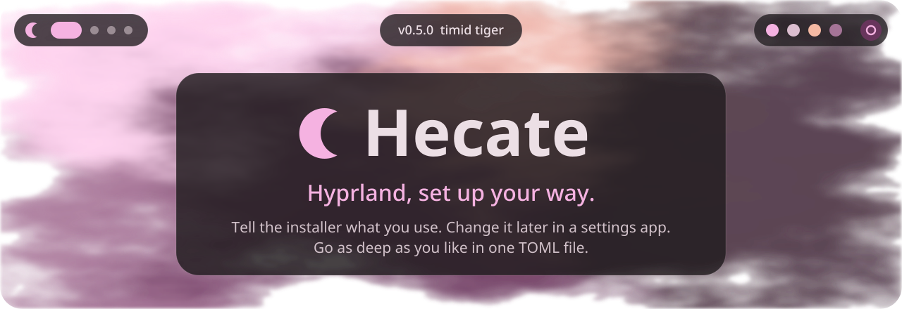
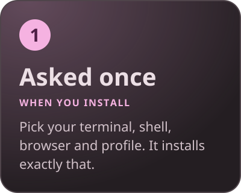
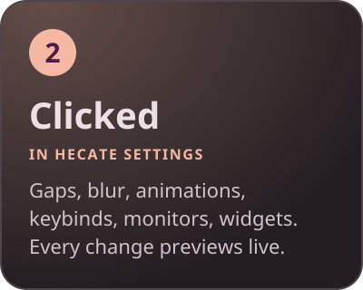
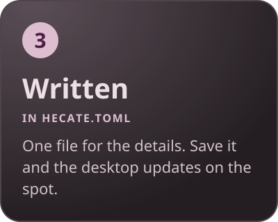
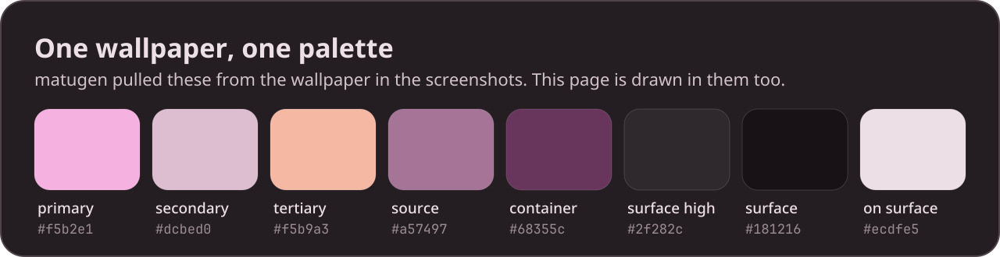

<div align="center">



<a href="version.txt"></a>
<a href="https://hyprland.org"></a>
<a href="documentation/Installation/arch.md"></a>
<a href="documentation/Installation/fedora.md"></a>
<a href="LICENSE"></a>

<a href="#install"></a>
<a href="#three-ways-to-make-it-yours"></a>
<a href="#hecate-settings"></a>
<a href="#hecate-toml"></a>
<a href="#keybindings"></a>
<a href="#troubleshooting"></a>
<a href="config/quickshell/README.md"></a>


</div>

<br>

## Three ways to make it yours

Most dotfiles hand you someone else's setup and a pile of config files. Hecate meets you at three depths, so you only go as far as you want to.

<div align="center">

<a href="#asked-once"></a>
<a href="#hecate-settings"></a>
<a href="#hecate-toml"></a>

</div>

<br>


<a id="asked-once"></a>

## ① It asks before it installs

No editing before your first login. The installer installs `gum` if it's missing, then asks:

| Question         | Choices                                    | What it changes                                              |
| ---------------- | ------------------------------------------ | ------------------------------------------------------------ |
| **Terminal**     | Kitty · Alacritty · Foot · Ghostty         | installed, and opened by <kbd>Super</kbd>+<kbd>Return</kbd>  |
| **Shell**        | Zsh · Bash · Fish                          | installed with fzf, bat and eza, and set as your login shell |
| **Browser**      | Firefox · Brave · Chromium · Google Chrome | installed, and opened by <kbd>Super</kbd>+<kbd>B</kbd>       |
| **Profile**      | minimal · developer · gamer · madlad       | the extra software, below                                    |
| **Colors**       | dynamic · static                           | whether colors follow your wallpaper                         |
| **Login screen** | hecate-sddm · Astronaut · none             | SDDM and its theme                                           |
| **Wallpapers**   | download a collection · bring your own     | `~/Pictures/Wallpapers`                                      |

Your answers are saved to `hecate.toml`, so changing your mind later is one line, not a reinstall. Your existing configs are backed up to `~/.cache/hecate-backup/` first.

<details>
<summary><b>The four profiles</b></summary>

<br>

| Profile       | Adds                                                                                                                      |
| ------------- | ------------------------------------------------------------------------------------------------------------------------- |
| **minimal**   | just Hecate                                                                                                               |
| **developer** | pick your areas: AI/ML, web, server/backend, databases, mobile, DevOps, game development                                  |
| **gamer**     | Steam, Lutris, Wine, GameMode, MangoHud; optionally Discord, emulators (RetroArch, PCSX2, Dolphin, RPCS3) and ProtonUp-Qt |
| **madlad**    | developer and gamer together; the installer warns that it can take an hour or two                                         |

</details>

<br>


<a id="hecate-settings"></a>

## ② Hecate Settings


A native app (Rust and QML) for everything\* you'd otherwise dig through Hyprland's config to change.

| Page                | What you can do                                                                                |
| ------------------- | ---------------------------------------------------------------------------------------------- |
| 🏠 **Home**         | change the wallpaper, see your system at a glance, and **arrange the bar and desktop widgets** |
| 🎨 **Decoration**   | rounding, gaps, borders, opacity, blur, shadows                                                |
| 🎞️ **Animation**    | shape bezier curves by dragging their handles, with a live preview                             |
| ⌨️ **Keybinds**     | add, edit and delete binds; conflicts are flagged before you save                              |
| 🖥️ **Monitors**     | drag monitors into place                                                                       |
| 📶 **Connectivity** | Wi-Fi, Bluetooth, volume and output device                                                     |
| 🔍 **Search**       | every Hyprland setting, not just the ones on these pages                                       |

**It never rewrites your config.** Changes apply to Hyprland straight away so you can see them, and nothing is saved until you press **Apply**. Then they go to `~/.config/hypr/hecate_overrides.lua`, which loads after your own config. **Revert** puts everything back. Bar and widget layout is saved to `hecate.toml`, keeping your comments, and the bar updates live.

Open it from the app launcher (<kbd>Super</kbd>+<kbd>D</kbd>), or the gear in the bar's control center. It's in beta; see [its README](apps/hecate-settings/README.md).

<br>


<a id="hecate-toml"></a>

## ③ One file for the details

`~/.config/hecate/hecate.toml` is where the finer points live. Save it and the shell applies the change at once; a value it can't use falls back to its default and says why in `qs log`, so a typo never breaks your desktop.


```toml
[preferences]           # your installer answers
term = "kitty"
browser = "firefox"

[theme]                 # the look of the whole shell
rounding = 16           # corner radius, 0 for square
opacity = 0.78          # how solid the glass is
blur = true
scale = 1.0             # size of everything
animation_speed = 1.0

[bar]
position = "top"        # or "bottom"
style = "islands"       # "islands", "floating" or "full"
left   = ["launcher", "workspaces", "windows"]
center = ["clock"]
right  = ["media", "tray", "status", "notifications", "power"]

[widgets.workspaces]
style = "dots"          # "dots", "numbers" or "icons"

[widgets.notifications]
popup = "top-right"
timeout = 5

[desktop]
left  = ["clock", "weather", "audio"]
right = ["system", "github", "apps"]
```

That's a taste. Nineteen bar widgets, nine panels, ten desktop cards and every option they take are in the **[shell README](config/quickshell/README.md)**.

<br>


## What you're configuring


<p align="center"><sub>Three wallpapers, three palettes. With dynamic colors, the shell follows whichever one you set.</sub></p>

<table>
<tr>
<td width="50%" valign="top">

**A shell built in Quickshell**

- a frosted-glass bar: workspaces, windows, clock, media, tray, status
- a control center: Wi-Fi, Bluetooth, do not disturb, keep awake, power mode, game mode, volume and mic
- app launcher, notifications, clipboard history, emoji, wallpapers, power menu
- desktop cards: clock, weather, media, system, GitHub, app tiles, keybinds, todo, updates, network

</td>
<td width="50%" valign="top">

**Around it**

- Hyprland with a Lua config, hyprlock layouts (`hecate lock` picks one), hypridle
- Kitty, Alacritty, Foot or Ghostty, sharing font and `ctrl+shift` keys (`termkeys` lists them)
- Starship, fastfetch, Dolphin, yazi, btop, Neovim
- optional colors from your wallpaper through matugen, for the shell, GTK and Qt apps, and the prompt

</td>
</tr>
</table>

<br>



<br><br>


## Install

Clone, run the installer, answer the questions. Your existing configs are backed up first.

> [!IMPORTANT]
> **Arch** and Arch-based systems (Manjaro, EndeavourOS, CachyOS) are supported.
> **Fedora** has an installer too ([guide](documentation/Installation/fedora.md)), but it is new and hasn't been tried on every release yet. Other distributions can follow the [manual install guide](documentation/Installation/manual-install.md).

```bash
git clone https://github.com/Nurysso/Hecate.git ~/Hecate
cd ~/Hecate
./install.sh
```

Or without cloning first:

```bash
bash <(curl -fsSL https://raw.githubusercontent.com/Nurysso/Hecate/main/install.sh)
```

`./install.sh --check` only checks for missing tools and fonts, and `--no-deps` skips packages and installs just the configs, Hecate Settings and wallpapers. paru or yay is recommended for the few AUR packages; the installer offers to build paru if you have neither. More in the [Arch guide](documentation/Installation/arch.md).

<br>

<a id="keybindings"></a>

<details>
<summary><b>⌨️ Keybindings</b></summary>

<br>

| Keys                                                                             | Does                                   |
| -------------------------------------------------------------------------------- | -------------------------------------- |
| <kbd>Super</kbd>+<kbd>Return</kbd> · <kbd>B</kbd> · <kbd>E</kbd>                 | your terminal · browser · file manager |
| <kbd>Super</kbd>+<kbd>D</kbd>                                                    | app launcher                           |
| <kbd>Super</kbd>+<kbd>V</kbd>                                                    | clipboard history                      |
| <kbd>Super</kbd>+<kbd>Alt</kbd>+<kbd>E</kbd>                                     | emoji picker                           |
| <kbd>Super</kbd>+<kbd>N</kbd> · <kbd>Shift</kbd>+<kbd>N</kbd>                    | Wi-Fi & Bluetooth · notifications      |
| <kbd>Super</kbd>+<kbd>Ctrl</kbd>+<kbd>W</kbd>                                    | wallpaper picker                       |
| <kbd>Super</kbd>+<kbd>Shift</kbd>+<kbd>Q</kbd>                                   | power menu                             |
| <kbd>Ctrl</kbd>+<kbd>Alt</kbd>+<kbd>L</kbd>                                      | lock                                   |
| <kbd>Super</kbd>+<kbd>Shift</kbd>+<kbd>S</kbd>                                   | screenshot an area                     |
| <kbd>Super</kbd>+<kbd>Q</kbd> · <kbd>F</kbd> · <kbd>Shift</kbd>+<kbd>Space</kbd> | close · fullscreen · float             |
| <kbd>Super</kbd>+<kbd>1</kbd>…<kbd>0</kbd>                                       | go to a workspace                      |
| <kbd>Super</kbd>+<kbd>Ctrl</kbd>+<kbd>1</kbd>…<kbd>0</kbd>                       | take the window there                  |
| <kbd>Super</kbd>+<kbd>Shift</kbd>+<kbd>1</kbd>…<kbd>0</kbd>                      | send the window there, stay here       |

Change any of them in Hecate Settings, or in `~/.config/hypr/configs/keybinds.lua`.

</details>

<details>
<summary><b>📜 The <code>hecate</code> command</b></summary>

<br>

| Command                          | Does                                     |
| -------------------------------- | ---------------------------------------- |
| `hecate check` · `hecate update` | look for updates · update the dotfiles   |
| `hecate theme`                   | switch colors between dynamic and static |
| `hecate lock`                    | pick a lock screen layout                |
| `hecate info`                    | show your installation                   |
| `termkeys`                       | list your terminal's keybinds            |

</details>

<a id="troubleshooting"></a>

<details>
<summary><b>🩺 When something's off</b></summary>

<br>

- **The bar or widgets are missing:** `qs log` shows errors with file and line; restart with `pkill -x quickshell; quickshell & disown`.
- **A `hecate.toml` change didn't take:** `qs log` names the value it ignored and why.
- **Hecate Settings won't open:** run `hecate-settings` in a terminal to see the error.
- **Settings don't survive a Hyprland reload:** Home shows **Overrides not loaded**; press **Add it**.
- **Something is missing after installing:** `./install.sh --check`.

</details>

<br>

<div align="center">


<br><br>

<a href="https://hyprland.org"></a>
<a href="https://quickshell.org"></a>
<a href="https://github.com/KDAB/cxx-qt"></a>
<a href="https://github.com/InioX/matugen"></a>

<sub>MIT licensed · made with ♥ by <a href="https://github.com/nurysso">nurysso</a></sub>

</div>
